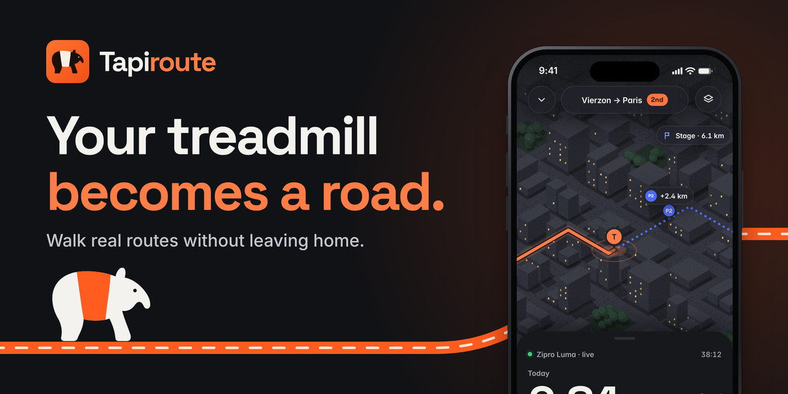

# Tapiroute

**Walk real-world routes on your treadmill.** Pick any start and destination (say, Lyon to Marseille) and every kilometre walked on your Bluetooth treadmill moves your pawn along the actual walking route, at a 1:1 scale. The trip takes weeks, session after session. Race your friends on the same route in real time.

> Tapiroute is in beta on iPhone and iPad (TestFlight). Its code name in the repository is Cap.

## Features

- Live 3D map following your pawn, with buildings, during each session.
- Treadmill connection over Bluetooth FTMS, tried on the Zipro Luma, with a wizard to add another treadmill and calibrate its speed.
- Safe walking routes, split into stages (towns along the way).
- Live races between friends, weekly, monthly and streak leaderboards, a feed with Bravos and comments.
- Routes published by the community and scheduled challenges.
- Push notifications for races, friends, the feed and streaks.
- No distance ever lost: sessions are saved on the phone and synced when possible.
- No location tracking, no ads, no analytics.
- iPhone and iPad, light and dark mode, French and English.

## Stack

| Part | Technology |
| --- | --- |
| App | Expo (native build), React Native, TypeScript, MapLibre + OpenFreeMap, react-native-ble-plx |
| API | Rust (Axum, Tokio, SQLx), PostgreSQL, WebSocket, APNs |
| Routing | Self-hosted GraphHopper (walking profile) and Photon (geocoding), OpenStreetMap data |
| Deployment | Docker Compose |

## Repository

| Path | Content |
| --- | --- |
| [`app`](app) | Expo app (iPhone and iPad) |
| [`api`](api) | Rust API: accounts, routes, journeys, sessions, races, community |
| [`infra`](infra) | Docker Compose: PostgreSQL, API, GraphHopper, Photon |
| [`tools/ble-probe`](tools/ble-probe) | Python tools to reverse-engineer a treadmill over Bluetooth, and the Zipro Luma protocol |

## Roadmap

- [x] Decode the treadmill from a PC
- [x] Foundation: Rust API, PostgreSQL, GraphHopper and Photon in Docker Compose
- [x] Solo loop: routes, live 3D map, session summary, offline sync
- [x] Multiplayer: friends, live races, leaderboards
- [x] Community: published routes, challenges, feed, badges
- [x] Push notifications
- [ ] TestFlight beta, then the App Store

## Contributing

See [CONTRIBUTING.md](CONTRIBUTING.md).

## License

[MIT](LICENSE). Map data © [OpenStreetMap](https://www.openstreetmap.org/copyright) contributors, tiles by [OpenFreeMap](https://openfreemap.org).
